---

<h3 align="center">Olá, eu sou o Thiago! ✌️</h3>

---

💻 Estudante de Ciência da Computação na UFCA, com foco em desenvolvimento FullStack. Sempre em busca de aprender novas tecnologias e aprimorar minhas habilidades. 🚀

---

  

---

 
        

---

 
  
   
  
   
  

